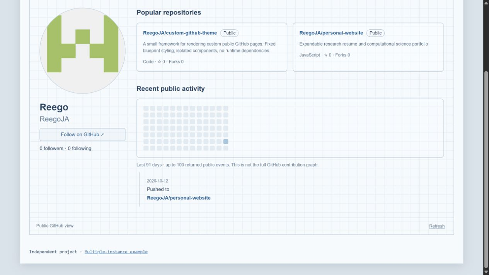

# Custom GitHub Theme

A small framework for displaying public GitHub profiles and repositories inside another website. Native web components, isolated styles, and in-page navigation, with a fixed blueprint design.

[Live demo](https://reegoja.github.io/custom-github-theme/) / [Multiple profiles](https://reegoja.github.io/custom-github-theme/examples/multiple.html) / [Download](https://github.com/ReegoJA/custom-github-theme/archive/refs/heads/main.zip)

Created October 12, 2026 / Version 0.1.0 / MIT / Reego John-Annaselvan



## Features

- Profiles, repositories, stars, followers, and following
- User and repository search, including `@username` and `owner/repository` shortcuts
- Branches, folders, text files, issues, pull requests, commits, and releases
- Paginated lists and in-component back navigation
- Independent instances and explicit lazy loading

## Integration

Copy the three files in `src/` into a `github-theme/` directory on your site, along with the MIT license. Add:

```html
<script type="module" src="./github-theme/github-theme.js"></script>
<github-profile username="octocat"></github-profile>
```

No dependencies, API key, or build step required. Serve over HTTP or HTTPS. In an SSR application, import the module only in the browser.

Change the `username` attribute to load another profile. Multiple elements have separate navigation state and isolated Shadow DOM styles. Edit the component markup and CSS directly to adapt the presentation.

For a hidden panel, defer requests until it opens:

```html
<github-profile id="profile" username="octocat" loading="lazy"></github-profile>
```

```js
await customElements.whenDefined('github-profile')
document.querySelector('#profile').load()
```

`loading="lazy"` requires calling `.load()`, it does not observe the viewport. The default username is `octocat`.

## Limits

This is a public GitHub API client. Sign-in and unsupported actions open GitHub.

- Unauthenticated API rate limits apply. Requests are cached in memory, Refresh clears the cache.
- The activity calendar shows up to 100 returned public events across 91 days, rather than the full contribution graph. Overview cards use the first 30 recently updated repositories, sorted by stars, rather than pinned repositories.
- UTF-8 file previews are limited to 250 KB. Markdown is displayed as text, binary files link out.
- Most lists use 30-item pages. Branch selection is limited to 100 branches, and issue/PR details show up to 30 comments.
- Requires a current browser supporting custom elements, Shadow DOM, ES modules, `AbortSignal.timeout`, and CSS container queries.

Requests go directly to `api.github.com` and `avatars.githubusercontent.com`. No credentials, analytics, or persistent storage are used. Sites with a Content Security Policy must allow these hosts for API requests and images respectively.

## Source

| Path | Contents |
| --- | --- |
| `src/github-theme.js` | Custom element, profile changes, and lazy loading |
| `src/github-browser.js` | API requests, navigation, and rendering |
| `src/github-theme.css` | Blueprint styles and responsive layout |
| `index.html`, `demo.css` | Standalone demo |
| `examples/multiple.html` | Independent profiles on one page |
| `assets/demo.jpg` | Demo screenshot |
| `scripts/serve.js` | Local demo server |
| `tests/github.test.js` | API-client tests |

For development, use Node.js 22+: `npm start` serves the demo at `http://127.0.0.1:4174`, `npm test` runs the tests. See [CONTRIBUTING.md](CONTRIBUTING.md).

## Credits and license

Maintained by Reego John-Annaselvan. [MIT license](LICENSE).

No third-party runtime libraries. Development tools use Node's built-in `http`, `fs/promises`, `path`, `test`, and `assert/strict` modules, maintained by Node.js contributors and the OpenJS Foundation.

GitHub provides the REST API, avatar service, and interface inspiration. This project is independent of GitHub, remote content retains its owners' rights.

Style references: [awesome-guidelines](https://github.com/Kristories/awesome-guidelines), by Kristories and contributors, Google's [JavaScript](https://google.github.io/styleguide/jsguide.html) and [HTML/CSS](https://google.github.io/styleguide/htmlcssguide.html) guides.

## History

Initial release: October 12, 2026. See [CHANGELOG.md](CHANGELOG.md) for release details.
